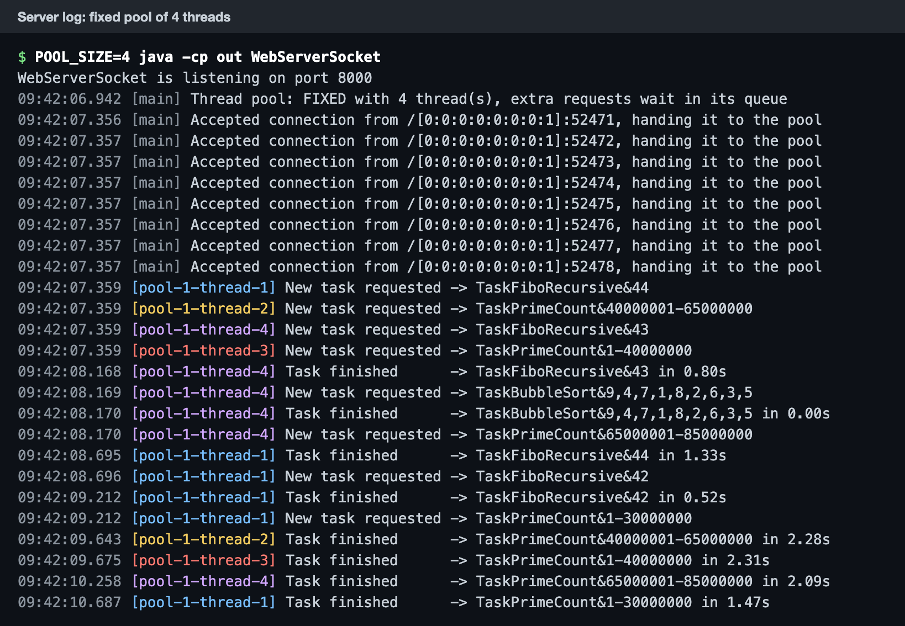

# Parallel Programming — Assignment 2: Thread Pools

Coursework for the Parallel Programming course (HIAST).
The assignment brief is in [`02 - Thread Pool Assignment.pdf`](02%20-%20Thread%20Pool%20Assignment.pdf).

| Part | What it asks for | Where it is |
|------|------------------|-------------|
| Question 1 | An architecture report on three thread-pool based systems | [`report/report-ar.pdf`](report/report-ar.pdf) (Arabic), [`report/report-en.pdf`](report/report-en.pdf) (English) |
| Question 2 | Extending, load-testing and dockerizing a multi-threaded task server | [`task-manager/`](task-manager), documented in the same report |

## Repository layout

```
task-manager/     the reference project with my changes (see below)
  src/            server, handlers, tasks
  test/           dependency-free tests
  scripts/        run-tests.sh, load-test.sh
  Dockerfile
report/
  report-ar.html, report-en.html   report sources (shared stylesheet: report.css)
  report-ar.pdf,  report-en.pdf    built reports
  evidence/       transcripts of every run: the command, then its unedited output
  screenshots/    the same transcripts rendered as terminal images
  build.py        renders the screenshots and builds the PDFs
```

`task-manager/` was imported from
[wagnerjfr/web-http-socket-server-task-manager-docker](https://github.com/wagnerjfr/web-http-socket-server-task-manager-docker)
with its history, so the original author's commits are still attributed to him.

## Running it

Everything below is run from `task-manager/`. Only a JDK (8 or newer) is needed.

```bash
./scripts/run-tests.sh                                      # 29 checks

javac -d out -sourcepath src src/*.java src/task/*.java     # build
java -cp out WebServerSocket                                # run on port 8000 (cached pool)
POOL_SIZE=4 java -cp out WebServerSocket                    # or: fixed pool of 4 threads
```

In a second terminal:

```bash
curl -d TaskPrimeCount -d 1-10000000 http://localhost:8000/   # the new task
curl -d TaskFiboRecursive -d 40 http://localhost:8000/        # an original task
curl http://localhost:8000/                                   # list of executed tasks
./scripts/load-test.sh                                        # eight requests at once
```

With Docker:

```bash
docker build -t task-manager .
docker run -d --name task-manager -p 8000:8000 task-manager
./scripts/load-test.sh && docker logs task-manager
docker rm -f task-manager
```

`docker run -e POOL_SIZE=4 ...` selects the fixed pool, and `-e WEBSERVER=WebServerHttp` the `HttpServer` variant.

## What changed in the reference project

| Change | Why |
|--------|-----|
| `task/TaskPrimeCount.java` (new) | The new task: counts the primes in `N` (1 to N) or `FROM-TO`. The server finds tasks by class name, so no registration is needed. |
| `util/Log.java` (new) | Every log line carries the time and the thread name, which is what shows how the pool distributes tasks. |
| `util/PoolFactory.java` (new) | `POOL_SIZE=n` selects `newFixedThreadPool(n)`; otherwise the original cached pool is kept. |
| `handler/RequestsHandlerSocket.java` | Sends a real HTTP response. The original wrote only the body, which `curl` rejects as HTTP/0.9. |
| `singleton/TasksList.java` | `add()` and `list()` are synchronized. The shared `ArrayList` lost entries under concurrent adds. |
| `Dockerfile` | `openjdk:8-jdk-alpine` no longer exists on Docker Hub; replaced with `eclipse-temurin:21-jdk-alpine`. |
| `test/`, `scripts/` (new) | Tests for the above, and a script that sends concurrent requests. |

## Result of the concurrency test

Eight requests sent together (four `TaskPrimeCount`, three `TaskFiboRecursive`, one `TaskBubbleSort`) on a 10-core
machine:

| Pool | Threads used | Whole batch | Speed-up over one thread |
|------|:-----------:|:-----------:|:------------------------:|
| cached (original) | 8 | 2.73 s | 3.7 x |
| fixed, 4 threads | 4 | 3.35 s | 3.0 x |
| fixed, 1 thread | 1 | 10.02 s | 1.0 x |



The full analysis is in the report.

## Rebuilding the report

```bash
python3 report/build.py              # screenshots from evidence/, then both PDFs
python3 report/build.py pdf          # only the PDFs, after editing report-*.html
```

It needs Python 3 and Chrome or Chromium (set `CHROME` to the binary if it is not found automatically).
